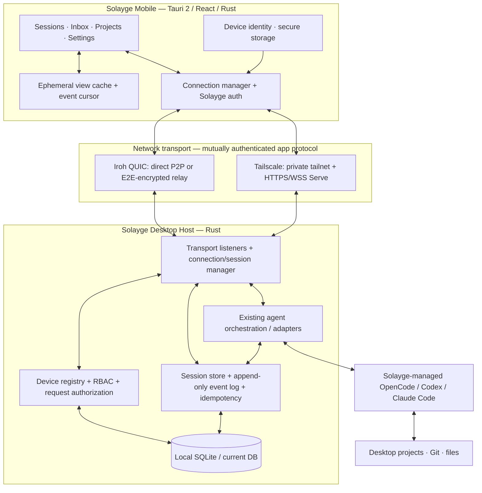
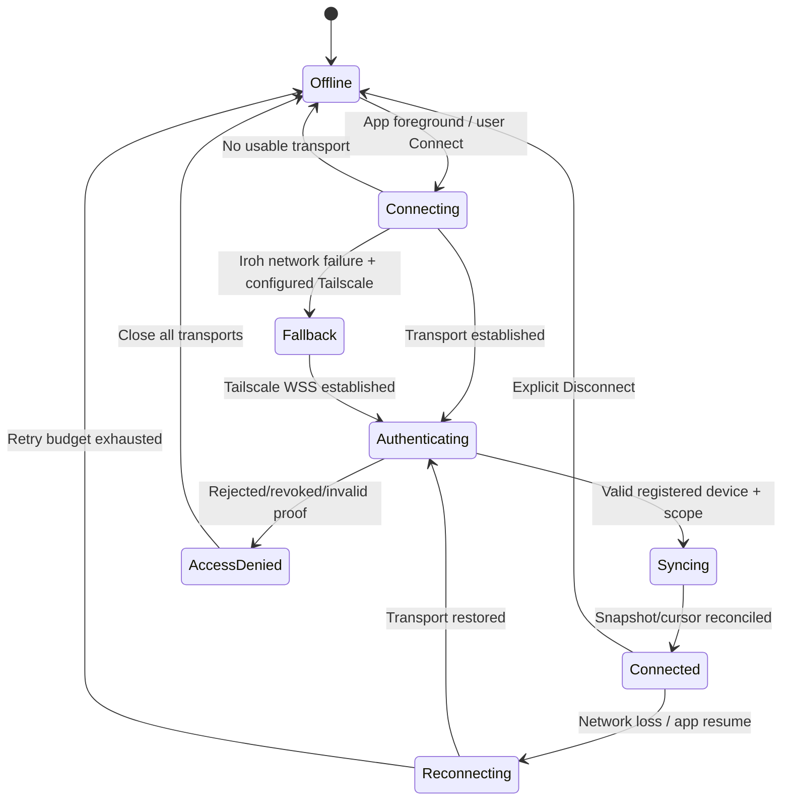

# Solayge Mobile: Product Specification, Architecture & Implementation Plan

**Status:** Proposed design / implementation-ready planning document  
**Research date:** October 8, 2026  
**Targets:** Android and iOS with Tauri 2; desktop host on macOS, Windows, and Linux  
**Owners:** Solayge product and engineering  
**Scope:** Mobile remote control of **Solayge-managed AI coding agents** on a user's desktop

> **Repository integration note:** This specification is based on the Solayge product direction discussed to date, **not an audit of the existing repository**. Implementation must begin by inspecting the current desktop application, agent/session orchestration, backend, persistence, UI components, authentication, and tests. Adapt the proposed crate layout rather than duplicating working systems.

## 1. Executive summary

Solayge Mobile is a secure companion application for monitoring and interacting with AI coding agents that execute on a user's desktop. Users pair a phone with a desktop using a QR code, then connect remotely through **Iroh by default** or an **optional user-configured Tailscale connection**. The desktop remains the authoritative host for projects, agent execution, permissions, and event history; the phone is an authenticated, lightweight control surface.

**Primary user promise:** *Leave the desk without leaving your agents unattended.*

Key experiences:

1. See which projects, tasks, and AI agents are active on the desktop.
2. Read live or historical agent conversations and task progress.
3. Answer agents' questions and approve or deny permission requests from the phone.
4. Send instructions, start supported tasks, and cancel supported operations.
5. Review summaries of changes and readable Git diffs.
6. Reconnect seamlessly after changing networks or reopening the mobile app.
7. Revoke a lost or untrusted phone immediately from desktop settings.

**Non-goals for the first release:** running coding agents on the phone; a universal remote terminal; public internet hosting; a mandatory Solayge account; a Solayge-hosted database of user code; guaranteed always-on mobile connections or notifications; attaching to arbitrary coding agents that Solayge does not manage.

### Product principles

- **Phone is a companion, not a miniature desktop.** Prioritize quick status, decisions, and short prompts.
- **Trust is independent of networking.** Possession of an Iroh endpoint ID or Tailscale access is not permission to control agents.
- **Desktop is the source of truth.** Network disconnects never imply agent cancellation.
- **Simple by default; expert controls on demand.** QR pairing and automatic connection before networking jargon.
- **Local-first and explicit privacy boundaries.** Solayge does not need to store source files or conversations in its own cloud. AI providers used by agents remain separate data processors.
- **No silent dangerous behavior.** No blanket approvals, public listener, insecure fallback, or hidden VPN setup.

## 2. Feature inventory and release priorities

Priority definitions: **P0 = first usable release**, **P1 = next iteration**, **P2 = later**. A feature is not “supported” until it works end-to-end with actual desktop agents and has appropriate tests.

| Area | Feature | Priority | Notes / definition of done |
|---|---|---|---|
| Mobile foundation | Tauri 2 Android/iOS app | P0 | Real devices, lifecycle handling, safe areas, platform permissions. |
| Connectivity | Iroh encrypted remote connection | P0 | Authenticated application session over QUIC; direct P2P where possible. |
| Connectivity | Iroh encrypted relay fallback | P0 | Explicit production relay configuration; disclose relayed state. |
| Connectivity | Optional Tailscale connection | P0 | User installs Tailscale separately; connects privately using Serve. |
| Connectivity | Automatic Iroh → Tailscale fallback | P1 | Only after Tailscale setup and successful connection test; never on auth failure. |
| Connectivity | Iroh Only / Tailscale Only mode | P0 | Useful for troubleshooting and user control. |
| Trust | QR pairing with desktop approval | P0 | Short-lived, single-use challenge; mutual identity verification. |
| Trust | Trusted-device list and revocation | P0 | Revoke across all transports and active sessions. |
| Trust | Permission scopes | P0 | View, message/control, approve actions, device admin separated. |
| Hosts | Select and switch among paired desktops | P0 | One active desktop context at a time. |
| Sessions | Active session list and live status | P0 | Project, agent, task, state, pending decision. |
| Sessions | Read chat / activity feed | P0 | Message and tool events, current step, timestamps. |
| Sessions | Send prompt / follow-up | P0 | Idempotent command ID; delivery state; safe retry behavior. |
| Decisions | Agent questions and action approvals | P0 | Structured request, scope, risk, expiry, audit trail. |
| Decisions | Unified pending-action inbox | P0 | Primary mobile value proposition, not buried inside chats. |
| Execution | Cancel/stop a supported agent operation | P0 | Distinguish cancel request from confirmed stop. |
| Execution | Start new supported task/session | P1 | Agent capability-aware; project and workspace selection. |
| Review | Files changed summary | P0 | Filenames, counts, additions/deletions if available. |
| Review | Mobile-readable Git diff | P1 | One file at a time, inline diff, collapsible hunks. |
| Continuity | Resume after app background/reconnect | P0 | Snapshot + event cursor; no duplicate commands. |
| Continuity | Cross-device handoff | P1 | Return to same task/chat on desktop or mobile. |
| Insights | Basic per-project task counts and durations | P1 | Read-only summaries from authoritative desktop metrics. |
| Insights | Token usage / estimated cost by agent | P1 | Only when provider reports usage; show estimation assumptions. |
| Insights | Error rate / error digest / repeated questions | P1 | Distinguish task failure from transport failure. |
| Notifications | Local in-app banners and pending badges | P0 | Foreground updates; no cloud service. |
| Notifications | Push alerts for approvals/completions | P2 | APNs/FCM requires separate design and metadata minimization. |
| Security | Biometric unlock for local sensitive UI | P1 | Convenience gate; never substitutes for host authorization. |
| Advanced | File preview and attachments | P2 | Must enforce workspace/file permissions and size limits. |
| Advanced | Remote terminal / arbitrary commands | **Out of scope** | High-risk product decision; do not piggyback on agent controls. |

### Recommended MVP cut

Ship a **real P0 vertical slice**: **pair phone → connect using Iroh → show active session → send message → receive reply → approve a request → disconnect/reconnect safely**. Add a manually configurable Tailscale-only mode in the same release or immediately afterward. Automatic cross-transport fallback comes **after** both modes are individually reliable.

## 3. How it works: user journeys

### 3.1 First-time pairing (no Solayge account required)

1. Desktop: **Settings → Connected devices → Add phone**.
2. Desktop shows a QR code and a brief explanation: “Scan with Solayge Mobile. You'll approve the request here.”
3. Phone: **Add desktop → Scan QR**; request camera permission only when the scanner opens.
4. QR contains protocol version, desktop **public** application identity, nonsecret reachability/bootstrap hints, and a short-lived, one-time pairing identifier. **Never** embed a reusable bearer credential or private key.
5. Phone generates an installation-specific application signing identity, opens a provisional authenticated connection, and proves possession of its private key.
6. Both sides show a short **verification code / fingerprint** tied cryptographically to the handshake. Desktop displays the phone's claimed name and permissions requested.
7. Desktop user explicitly selects **Approve phone**; default permission is **View + Message**, not administrative access or broad agent permission approval.
8. Desktop stores authorized public key and scopes. Phone stores desktop public identity and local private key securely.
9. Phone opens the active-session overview. A canceled or expired pairing leaves no authorized device.

**Manual pairing alternative:** show a one-time pairing code and authenticated endpoint details for users without working camera access. A code is a bootstrap aid, not a bypass of explicit desktop approval or cryptographic identity checks.

### 3.2 Everyday remote interaction

1. Open Solayge Mobile; select a paired desktop (remember last selection).
2. Connection manager tries the user's preferred transport, authenticates the Solayge identity, and synchronizes the latest event cursor.
3. Home emphasizes **Needs your input**, **Running**, and **Recent** sessions.
4. Tap a session to read compact agent output and a clear current step (e.g., “Running tests”).
5. Send a prompt; immediately show **Sending → Received by desktop → Accepted by agent → Completed/Failed**, as applicable. Do not mark accepted merely because a network packet was sent.
6. If the agent requests permission, create an Inbox item with *what*, *why*, *which project/files/command*, *risk*, and **Approve once / Deny**. Approving is a fresh, scoped authorization for this request only.
7. When the phone goes offline, the desktop continues executing. Reopening re-authenticates, replays missed events, and restores the selected session.

### 3.3 Iroh failure and Tailscale fallback

- **Automatic mode:** Try Iroh direct/relay. If **connectivity** fails after bounded attempts and the user previously configured and tested Tailscale, try the private Tailscale endpoint. Re-run application identity authentication, then resume event synchronization.
- **Never fallback on an authentication or authorization denial.** Switching networks must not overcome revocation.
- **If Tailscale is not set up:** show “Can't reach this desktop” with **Retry**, **Set up Tailscale**, and **Connection details**. Do not launch a confusing sign-in flow automatically.
- **Tailscale-only mode:** mobile uses the installed system Tailscale app/VPN and Solayge's configured private endpoint. Solayge does not embed a VPN or provision accounts.
- **Privacy:** Both products can relay encrypted traffic. Tailscale succeeding where Iroh failed is plausible, **not guaranteed**.

### 3.4 Lost phone / compromise

Desktop → Connected devices → select device → **Revoke access**. Host immediately terminates that device's active application sessions, invalidates its authorization/refresh state, rejects every transport, and records the security event. A formerly paired phone sees “Access revoked” and must be re-paired with desktop approval.

## 4. System architecture

### 4.1 End-to-end diagram



**Trust boundaries:** (1) mobile UI vs. privileged native code; (2) mobile ↔ untrusted network; (3) network connection ↔ authorized Solayge device; (4) remote command ↔ desktop host authorization; (5) host ↔ agent providers and local files. Enforce security at the boundary nearest the protected resource.

### 4.2 Components and responsibilities

| Component | Responsibility | Critical design rule |
|---|---|---|
| Mobile React UI | Readable sessions, prompts, decisions | No direct unrestricted OS capability access. |
| Mobile Rust bridge | Keys, connection lifecycle, message client | JS never receives raw private keys. |
| Connection manager | Transport policy, handshake, health, failover | Connectivity errors ≠ authorization errors. |
| Iroh adapter | QUIC streams, endpoint discovery, relay config | Use maintained library; don't write crypto or NAT traversal. |
| Tailscale adapter | WSS client to Tailscale Serve endpoint | Validate HTTPS certificate and Solayge peer identity. |
| Desktop host process | Always-available *while desktop awake* remote API | Separate lifecycle from visible window where practical. |
| Device registry | Identity, scopes, revocation | Central source of truth across transports. |
| Agent/session manager | Start/continue/cancel supported sessions | Desktop remains execution authority. |
| Event store | Resumption, replay, audit metadata | Monotonic stream cursors, retention rules. |
| Agent adapters | Translate provider capabilities | ACP where stable/supported; provider API elsewhere. |

### 4.3 Proposed repository structure (illustrative)

```text
solayge/
├── apps/
│   ├── desktop/                 # Existing desktop Tauri app / React
│   └── mobile/                  # New Tauri 2 Android + iOS app
├── crates/
│   ├── solayge-protocol/       # Versioned DTOs, validation, command IDs
│   ├── solayge-identity/       # Signing, handshake, pairing, permissions
│   ├── solayge-network/        # Connection manager, Iroh, Tailscale WSS
│   ├── solayge-host/           # Desktop-only host endpoints/authorization
│   └── solayge-agent-bridge/   # Adapter around existing agent orchestration
├── packages/
│   ├── shared-types/           # Generated types if useful
│   └── shared-ui/              # Selectively shared design tokens/components
└── docs/mobile/               # Threat model, setup, protocol, QA
```

**Do not** refactor the whole repo to match this tree. First map existing crates/modules; implement abstractions only where needed to achieve a tested vertical slice. Prefer a small shared protocol crate over sharing the entire desktop backend with mobile.

## 5. Networking and device trust design

### 5.1 Transport behavior

| Property | Iroh | Tailscale |
|---|---|---|
| Configuration | Built into Solayge's Rust networking | Existing Tailscale app/account on desktop and phone |
| Connection | QUIC by endpoint identity | HTTPS/WebSocket to private Serve URL |
| Direct P2P | Attempted automatically | Usually attempted by Tailscale |
| Relays | Iroh relays when direct path unavailable | DERP/peer relay when direct path unavailable |
| Server operated by Solayge | No app-data server required; **reliable production Iroh relay/discovery still needs a plan** | No Solayge relay required for user's tailnet |
| Auth beyond network | **Required** | **Required** |
| Setup UX | QR pairing and connect | Explicit guided setup; test endpoint |
| Failure mode | Relay blocked, discovery unavailable, peer offline | VPN absent/off, wrong tailnet, Serve off, policy restriction |

**Iroh commercial-readiness note:** Iroh's public infrastructure is free, rate-limited, and lacks uptime guarantees; its managed service advertises **$19/month and up** as of this research date. This is an infrastructure planning input, **not** Solayge's quoted operating cost. Self-hosting is an option but carries operations, bandwidth, abuse prevention, TLS, monitoring, and availability costs. [Iroh hosting](https://www.iroh.computer/services/hosting).

**Direct-only policy:** expose it only if the chosen Iroh API can reliably enforce no relay-carried application data. A relay may still be involved in bootstrap/discovery depending on implementation. Document exact semantics; do not promise “no third-party infrastructure” without verification.

**Tailscale Serve:** desktop binds an authenticated Solayge protocol server to **127.0.0.1**, then user-configured Tailscale Serve exposes it **only to the tailnet**, typically over `https://device.tailnet.ts.net`. Mobile connects using `wss://...` with strict TLS verification. Tailscale HTTPS certificates and grants/ACLs must be set correctly. **Do not use Funnel**, which exposes services publicly. Validate contemporary `tailscale serve` CLI syntax during implementation. [Serve docs](https://tailscale.com/docs/features/tailscale-serve).

### 5.2 Connection preference and state machine

Modes: **Automatic (recommended)**, **Iroh only**, **Tailscale only**. Automatic tries Iroh's usable direct/relayed path first; Tailscale comes after a configured health-checked fallback. Provide per-desktop overrides without surprising global side effects.



- Use capped exponential backoff with jitter and max retry budgets.
- Do not repeatedly race transports in a way that creates duplicate application sessions.
- Show granular diagnostics only when useful; never show “Connected” until **Solayge app authentication and synchronization** succeed.
- On an agent command timeout, query `command_id` state after reconnect instead of resending blindly.

### 5.3 Cryptographic identity and pairing

- Persist a stable **Solayge application identity** per device; public key is trusted only after human-approved pairing.
- Recommended signing primitive: Ed25519 using a mature audited library, with fresh authenticated session establishment and challenge-response. Bind identity to the transport channel/session to mitigate channel confusion and active interposition attacks; obtain independent cryptographic review of exact handshake design.
- Store keys in **Keychain** (Apple), or use **Keystore-backed encryption/wrapping** and appropriate Android secure storage. On desktop use OS credential protection where available. Hardware-backed raw Ed25519 signing is not uniformly available across devices; don't assert every key is hardware-backed.
- A key stored on a rooted/jailbroken device may be compromised; no design guarantees protection against a fully compromised endpoint.
- Pairing requests expire quickly, are single-use, rate-limited, and require explicit approval on the desktop.
- Derive verification digits/fingerprint from both device identities and current pairing transcript; a QR alone must not confer trust.
- Support mobile lock-screen protection and optionally biometric access to the app UI; biometrics never authorize backend operations in place of key authentication and host-side scopes.

### 5.4 Host-side permission model

| Scope | Allowed | Not allowed by default |
|---|---|---|
| `sessions.read` | Projects/sessions/status and filtered logs | Reading arbitrary local files |
| `sessions.message` | Send prompts and agent answers | Executing arbitrary shell commands |
| `sessions.control` | Start/cancel supported operations | Kill arbitrary OS processes |
| `approvals.respond` | Accept/deny **one specific** agent request | Persistent “auto-approve everything” |
| `devices.manage` | Revoke/manage trusted devices | Granted to newly paired phones by default |

Requests carry project/session IDs; host checks **device identity + permission scope + allowed project + current request state**. Treat structured approval content as untrusted: display exact relevant command, target file/path, risk and request expiry. Prevent stale or modified approval replay by referencing an immutable permission-request ID and content hash. Use an explicit audit record for sensitive actions with redacted context. Device revocation must close active sockets and invalidate application capabilities immediately.

## 6. Remote protocol, storage, and agent integration

### 6.1 Versioned application API (proposed, not an existing contract)

Use a single transport-neutral message envelope over Iroh streams and Tailscale WebSockets. Example:

```json
{
  "protocol_version": 1,
  "message_id": "01J...",
  "kind": "command",
  "action": "session.send_prompt",
  "desktop_id": "desktop-public-id",
  "session_id": "session-123",
  "command_id": "unique-idempotency-key",
  "payload": { "text": "Run the tests and summarize failures." }
}
```

Commands should support status transitions: `created → delivered → accepted → running → succeeded/failed/canceled/unknown`. In a transport timeout, `unknown` is **not** equivalent to `failed`. Keep request/response correlation, typed errors, maximum frame sizes, limits on concurrent streams and attachment sizes, cancellation, and bounded queues. Avoid serializing credentials or entire environment variables.

**Recommended API surface:**

```text
pair.begin / pair.prove_identity / pair.approve / pair.reject
connection.authenticate / connection.health
hosts.get_metadata
projects.list
sessions.list / sessions.get / sessions.events.subscribe
sessions.send_prompt / sessions.get_command_status
sessions.cancel / sessions.start (if agent supports it)
approvals.list / approvals.get / approvals.respond
files.changed_summary / files.diff (P1)
insights.summary / insights.errors / insights.agent_questions (P1)
devices.list / devices.revoke (desktop admin only)
```

### 6.2 Event sync and persistence

- Desktop emits immutable events per session (`seq`, `event_id`, `event_kind`, timestamp, payload metadata, retention class).
- On reconnect, mobile presents last acknowledged `seq`. Host replies with missing events or a **consistent snapshot + new cursor** if the history has been pruned.
- Mobile deduplicates by event and command IDs; host deduplicates commands transactionally before agent dispatch.
- Store live-session metadata, command outcome, pairing registry and audit events in the **existing Solayge persistence layer**; SQLite only if no suitable existing store exists.
- Mobile cache only the minimum necessary data, with configurable retention and an easy **Clear cached data** action; avoid plaintext sensitive conversation caching without at-rest encryption.
- Concurrent devices may read the same session; mutating operations are serialized/authorized by the host, with clear request ownership and stale-decision rejection.
- Recording full agent transcripts is optional and controlled by Solayge's existing history/privacy settings; don't silently enable broader retention.

### 6.3 Agent provider bridge

Re-use Solayge's current agent manager, processes, session IDs, approval pipeline, task states, and metrics. The mobile app must not start a second set of provider-specific subprocesses. Use **ACP** when a stable supported agent adapter makes sense; the official Rust ACP SDK includes client, agent, proxy, and WebSocket-related components. The SDK also documents a draft v2: prefer a stable compatible surface rather than unreviewed experimental APIs. [ACP Rust SDK](https://github.com/agentclientprotocol/rust-sdk).

Capability-gate UI per adapter:

| Capability | Approach |
|---|---|
| Read messages and statuses | Normalize events from Solayge's existing sessions. |
| Send prompt | Forward through existing supported agent interface. |
| Approval request | Show only when provider/host exposes actionable structured request. |
| Cancel | Implement provider-specific cancel and confirm resulting state. |
| Git changes | Obtain from desktop Git/workspace integration, not guessed agent text. |
| Usage/cost | Read provider usage records where available; estimate only with visible assumptions. |
| Attach to external CLI session | **Not assumed.** Separate product research and adapter work. |

## 7. UX research and design decisions

The recommendations below are a **design synthesis** from platform guidelines and UX research, not the result of usability testing with Solayge customers.

| Source / finding | Applied Solayge decision |
|---|---|
| [Apple: tab bars](https://developer.apple.com/design/human-interface-guidelines/tab-bars) — use tabs for top-level destinations, with readable labels and a small number of sections. | **Sessions · Inbox · Projects** bottom tabs; desktop/device switcher in header, Settings in header/profile. Avoid a desktop-like sidebar on a phone. |
| [Android layouts/navigation](https://developer.android.com/design/ui/mobile/guides/layout-and-content/layout-and-nav-patterns) — navigation bars fit about 3–5 peer destinations; navigation rail on larger screens. | Shared 3-tab information architecture; responsive rail/split-pane on tablets. |
| [NN/g: progressive disclosure](https://www.nngroup.com/articles/progressive-disclosure/) — show frequent tasks first; advanced details in secondary views. | Default “Connected” rather than QUIC/NAT jargon. Put relay, endpoint, latency, and troubleshooting under **Connection details**. |
| [NN/g: visibility of system status](https://www.nngroup.com/articles/visibility-system-status/) — clear action feedback reduces uncertainty. | Always distinguish **Running**, **Waiting for your answer**, **Syncing**, **Offline**, **Access revoked**; show meaningful message-send status. |
| [NN/g: complex-app waits](https://www.nngroup.com/articles/designing-for-waits-and-interruptions/) — show current step/progress and make history available, especially for long-running work. | Activity timeline with tool step, elapsed time, last update, “agent still working” vs. stalled; no fake percentage. |
| [Apple: layout](https://developer.apple.com/design/human-interface-guidelines/layout) — respect device safe areas and prioritize essential content. | Sticky message composer above keyboard/tab bar; safe-area padding; no critical controls behind notches or home indicator. |
| [W3C: WCAG 2.2 Target Size](https://www.w3.org/WAI/WCAG22/Understanding/target-size-minimum) — minimum accessible hit areas/spacing. | Use **44–48 px equivalent** for primary touch targets where practical (product target), comfortably above the WCAG 24 CSS-pixel minimum. |
| [Tauri: mobile barcode scanner](https://v2.tauri.app/plugin/barcode-scanner/) — official QR scanner can integrate with mobile app and explicit permissions. | Native QR scan entry point; request camera permission in context; fallback to manual pairing. |

### 7.1 Mobile information architecture

**Bottom navigation: three primary destinations**

1. **Sessions** (default): what is running, what just finished, latest projects/tasks; opens conversation and activity.
2. **Inbox**: pending agent questions, approvals, recoverable failures and actionable errors, each with urgency and session context.
3. **Projects**: browse project → tasks/sessions → status, history, changed files; search and filters.

**Header:** selected desktop with connected/disconnected indicator; tap to switch desktops. **Settings** via gear/avatar includes Devices, Network, Security, Privacy, Diagnostics. **Insights** is a P1 secondary destination reached from Projects or overflow; promote it to a fourth tab only if real usage supports it. This protects the core workflow from navigation clutter.

**Why Inbox deserves a primary tab:** remote phone sessions are often short “interventions”: answer a question, approve a command, unblock a stalled task. Making pending decisions one tap away is more useful than giving analytics its own main tab during MVP.

### 7.2 Screen-by-screen interaction specification

#### A. First launch / desktop selector

```text
┌────────────────────────────────┐
│ Solayge                 Settings│
│                                │
│ Your desktops                  │
│ ┌────────────────────────────┐ │
│ │ MacBook Pro        Connected│ │
│ │ 2 agents running · 1 needs │ │
│ │ your answer                 │ │
│ └────────────────────────────┘ │
│                                │
│ + Add a desktop                │
│                                │
│ Sessions     Inbox    Projects │
└────────────────────────────────┘
```

- If exactly one paired host: skip selector after reconnect; show it via header.
- If no host: empty state with **Connect to your computer**, **Scan QR code**, “Your computer must be running Solayge,” and **How it works**.
- If offline: show last-known information explicitly labeled **Last updated …**; disable actions that require connection.

#### B. Sessions home

```text
┌────────────────────────────────┐
│ MacBook Pro       ● Connected ▾│
│                                │
│ Needs your input          1    │
│ ┌────────────────────────────┐ │
│ │ ! Approve: run test script │ │
│ │ FileQuell · Codex · 2m ago │ │
│ │ [Review request]           │ │
│ └────────────────────────────┘ │
│                                │
│ Running                    2   │
│ ● Solayge · Refactor UI        │
│   Claude Code · Running tests  │
│   12m elapsed                  │
│                                │
│ ● FileQuell · PDF import       │
│   OpenCode · Editing 3 files   │
│                                │
│ Recent                         │
│ ✓ Build passed · 10:42         │
│                                │
│ Sessions     Inbox    Projects │
└────────────────────────────────┘
```

- Sort **needs input**, **active**, then **recent**; avoid giant dashboard metrics at top.
- Each row has project, task name, agent/provider, current state, last meaningful activity, and pending count.
- Do not imply that elapsed runtime equals estimated remaining time.
- Search/filter for multi-project users; virtualize long lists; preserve selection on return.

#### C. Session/chat detail

```text
┌────────────────────────────────┐
│ ‹ Sessions   Refactor UI     ⋯ │
│ Claude Code  ● Running tests   │
│                                │
│ Latest summary                 │
│ Updated 3 components; now      │
│ running frontend tests.        │
│                                │
│ Activity                       │
│ ✓ Edited SessionView.tsx       │
│ ✓ Edited NetworkPanel.tsx      │
│ ◌ Running unit tests...        │
│                                │
│ [View full conversation]       │
│ [Files changed: 2]            │
│                                │
│ ┌────────────────────────────┐ │
│ │ Message your agent…        │ │
│ └────────────────────────────┘ │
│ [Send]             [Stop task] │
└────────────────────────────────┘
```

- Default to **summary + current step + critical events**, with full transcript expandable. Agent chatter/tool trace can be huge; collapse noise by default.
- Keep composer usable with soft keyboard, landscape, safe areas and screen readers.
- Clearly signal when content is streaming, accepted, queued, or stale. Include “Tap to retry” only when command outcome is known not to have executed.
- Use optional **copy** actions for code/paths. Inline syntax-highlighted code scrolls within a bounded region; never force the entire page to scroll sideways.
- Stop/cancel is visually distinct from Send; confirmation is conditional on destructiveness and supported semantics.

#### D. Inbox / decision view

```text
┌────────────────────────────────┐
│ Inbox                    2     │
│ [Needs decision] [Questions]   │
│                                │
│ FileQuell · Codex              │
│ Run command?                   │
│ cargo test --workspace         │
│ Requested 2 min ago            │
│ [Review]                       │
│                                │
│ Solayge · OpenCode             │
│ Which API should I use?        │
│ [Answer question]              │
│                                │
│ Sessions     Inbox    Projects │
└────────────────────────────────┘
```

**Approval detail must show:** desktop, project/workspace, agent, precise command or file operation, affected scope, reason, limitations, time requested, expiry, and whether action is read-only or can modify files/exfiltrate data. **Deny** and **Approve once** must be equally understandable; disable action after one definitive decision. For high-impact approvals, require a second explicit confirmation or biometric UI unlock (defense in depth). **Do not** group distinct risky commands under an ambiguous “Approve all” button.

**Agent questions:** render concise question, structured choices if supplied, and editable response. Distinguish *question* from *permission* so a normal answer never becomes code-execution authorization. Add filters for “Unanswered,” “Answered,” “Expired.”

#### E. Projects + Insights (P1)

Project list: name → running/blocked/completed task counts → recent activity. Project detail has **Tasks**, **Changes**, **Insights**. For a project Insights screen show **completed tasks**, **avg task duration** (p50 recommended), **failure rate** with numerator/denominator, **tokens** and **estimated cost** if available, and **repeated questions** grouped by normalized intent. Label unknown token usage as **Not reported** and missing price mapping as **Estimate unavailable**, not zero.

Insights should not crowd P0 mobile home. A mini summary such as “3 running · 1 blocked” is enough for fast checks; deeper metrics are better under Project detail/Insights.

#### F. Network settings and diagnostics

```text
Connection method
(•) Automatic — recommended
( ) Iroh only
( ) Tailscale only

Connected via Iroh
Direct connection · Last sync just now
[Connection details]

Tailscale (optional)
Not configured
[Set up Tailscale] [Test connection]
```

- “Automatic” helper: “Uses Iroh first. If it can't connect, tries your already configured Tailscale connection.”
- Show **what to do next**, not just error numbers: *“Open Tailscale on both devices, then test again.”*
- Advanced details include endpoint type, relay/direct (when verifiable), RTT, authentication, app version, last error, sanitized diagnostics export.
- Warn if desktop is asleep or Solayge Host is not running. No fake “encrypted” check mark based only on attempted connection.

### 7.3 UI design system

- **Visual language:** retain existing Solayge brand, components, iconography and spacing; mobile should feel like the same product, not a new unrelated app.
- **Typography:** clear hierarchy; roughly 16 px comfortable body text; avoid tiny monospaced diagnostics in main surfaces; support Dynamic Type/text scaling where possible.
- **Colors:** dark/light appearance according to OS and user preference; color never communicates task status alone. Combine icon + text for Running, Waiting, Failed, Offline.
- **Interaction:** touch targets 44–48 px equivalent for primary controls; haptic confirmation for high-impact actions where supported; visible focus and reduced-motion support.
- **Accessibility:** screen reader labels, contrast, keyboard behavior, landscape, safe areas, RTL-safe layout if internationalized, plain-language errors.
- **Responsive:** phones use bottom tabs and single pane; tablets/landscape can use navigation rail and split view; do not reuse desktop table layouts directly.
- **Offline:** last-known read-only state, clear sync timestamp; do not queue destructive or ambiguous commands silently.

### 7.4 UX experiments to validate

Conduct 5–8 moderated usability sessions with developers on actual phones (not only browser responsive mode). Measure: pairing completion/time, find a blocked task, approve a specific command without confusion, recognize offline vs. running, switch desktop, send a follow-up, recover after interruption. Log critical misinterpretations (especially *approved wrong request*). Test at least one iPhone and multiple Android sizes; user feedback can change whether Inbox is the default screen.

## 8. Desktop UX additions

**Settings → Connected devices**: list name/platform, trust scope, paired date, last seen, online status, revoke action, Add phone. Do not show a misleading “online” state when it only means registered.

**Settings → Network**: Automatic / Iroh only / Tailscale only, current connection, Iroh relay policy, Tailscale guide, Test connection, diagnostics. Remote host should bind loopback by default for Serve mode; never expose an unauthenticated public HTTP listener.

**Session view**: shared session metadata and host-authoritative statuses; display a discreet “Connected mobile clients” indicator when useful, without exposing sensitive phone identity to unrelated users.

**Desktop host lifecycle:** minimize/hide window without killing sessions. Choose among Tauri tray behavior, an unprivileged background helper, or a user-level service only after reviewing current process model. Respect explicit quit, OS sleep, app sandbox restrictions and platform update mechanisms. Do not promise tasks run while the computer is sleeping.

## 9. Mobile operating-system constraints

- **Tauri 2:** supports Android/iOS, but individual plugins/dependencies must be verified per target and version. Tauri's official barcode scanner plugin provides a mobile QR route; app capabilities must grant scanner permissions explicitly. [Prerequisites](https://v2.tauri.app/start/prerequisites/), [Barcode scanner](https://v2.tauri.app/plugin/barcode-scanner/).
- **iOS:** normal apps may be suspended after going to background; do not rely on a permanent QUIC/WSS socket. Reconnect and sync on foreground; protect sensitive app-switcher snapshots. [Apple background execution](https://developer.apple.com/documentation/uikit/preparing-your-ui-to-run-in-the-background).
- **Android:** background network/service behavior varies with OS and OEM restrictions; avoid permanent polling. Reconnect on activity resume and network availability. [Android restrictions](https://developer.android.com/develop/background-work/background-tasks/bg-work-restrictions).
- **Push notifications:** not P0. Future APNs/FCM notifications need separate design, opt-in, and a privacy-preserving delivery architecture. An optional relay/push service should not receive repository files, tool output or full conversations.
- **Network shifts:** Wi-Fi → LTE → VPN reconnect can change reachability and path. Treat connection interruption as normal, not failure of the task itself.
- **Battery:** event-driven streams while foreground, sensible heartbeat, bounded reconnection attempts, release sockets on lifecycle changes.

## 10. Security and privacy threat model

| Threat | Mitigation / test |
|---|---|
| QR intercepted/copied | Expiring single-use bootstrap; no reusable auth secret; identity proof and desktop approval. |
| Fake desktop during pairing | Identity fingerprint / short verification code bound to handshake transcript; reject identity changes silently attempted. |
| Lost/stolen phone | Platform secure key storage, optional UI lock, immediate host revocation, short-lived session capabilities. |
| Device on same tailnet but not authorized | Solayge cryptographic authentication and host RBAC on **every** connection. |
| Replay / double-send | Unique command IDs, persistent idempotency, state query on uncertain outcomes. |
| Transports bypass scopes | Common authorization service; transport-independent device identity and revocation. |
| Malicious/compromised mobile UI | Backend-enforced capabilities; no generic remote shell; narrow Tauri IPC permissions. |
| Prompt injection through agent output | Treat remote content as data; no automatic approvals/actions induced by displayed content. |
| Approval content swapped after display | Immutable approval/request ID, hash of exact request, expiry and host-side compare-and-set. |
| Sensitive data in logs | Structured redaction, safe diagnostics export, retention and local deletion controls. |
| Untrusted URL/link in agent output | Warning/external-browser opening controls; prevent JS execution from rendered Markdown/HTML. |
| Abuse / resource exhaustion | Frame limits, auth throttles, concurrency quotas, queue limits, timeouts, payload validation. |
| Misleading “P2P-only” privacy | Label direct vs relayed accurately; document discovery/relay and AI-provider metadata. |

**Minimum security deliverables:** written threat model, authorization matrix, external dependency review, protocol validation, pairing/revocation integration tests, audit of remote command endpoints, mobile/desktop secure storage review, and an independent pre-release security review if commercially distributing.

## 11. Delivery plan (phased vertical slices)

These are **ordered engineering milestones, not time estimates**. Do not mark a phase complete based on mock data alone.

| Phase | Work | Exit criteria / demo |
|---|---|---|
| **0. Repo discovery** | Inventory Tauri version, Rust crates, agent manager, session store, build/test pipeline, security boundaries and existing design system. | Architecture map + decisions log; identified extension points. |
| **1. Shared contract** | Protocol schemas, device IDs, auth interface, scopes, event IDs, command idempotency, transport interface, tests. | Local loopback test exchanges authenticated messages; malformed/replay cases rejected. |
| **2. Desktop host** | Host lifecycle, registered-device store, project/session read APIs, event replay, per-request auth. | Desktop continues a Solayge-managed session without open main window, where platform permits. |
| **3. Iroh connection** | Desktop/mobile Iroh endpoints, QUIC, discovery/relay configuration, diagnostics. | Remote phone securely reads a real session over Iroh; retry/disconnect test. |
| **4. QR registration** | Native QR scan, desktop approval UI, identity proof, scopes, revoke. | Pair and revoke real phone; unknown/stolen device denied across reconnects. |
| **5. First agent control** | Agent bridge, send prompt, streaming, cancel where supported, command status, pending approval response. | Phone prompts actual coding agent and receives real output; permission approval only after exact host validation. |
| **6. P0 mobile UX** | Sessions, Inbox, Projects, chat/detail, empty/error/offline states, Settings, accessibility. | End-to-end happy path on real iOS and Android devices with clear failure states. |
| **7. Tailscale manual mode** | Loopback WSS-compatible service, Serve setup guide, Tailscale-only mode, endpoint verification and auth. | Phone works over real Tailscale without Iroh; no public exposure. |
| **8. Automatic fallback** | Policy engine, timeout/retry budget, handover, reauth, event resume, diagnostic reasons. | Iroh transport failure → configured Tailscale → same session, no duplicate execution. |
| **9. Hardening / release** | Threat review, real-network matrix, lifecycle/battery testing, crash recovery, dependency/license audit, documentation. | Acceptance matrix passes; known limitations documented; production relay plan approved. |
| **10. P1 enhancements** | Git diff, mobile start task, device biometrics, rich Insights, multiple-host polish. | Measured user value and tested per-provider capabilities. |

### Engineering task breakdown

**Backend / Rust:** `solayge-protocol` DTOs; `solayge-identity` trust; `solayge-network` adapters; host pairing registry; host RBAC; durable event stream/idempotency; agent manager bridge; diagnostics.

**Mobile / frontend:** device onboarding, native scan, host switcher, session list, inbox, conversation, streamed events, approval detail, network settings, connection error UX, skeleton/offline/resume flows, secure cache.

**Desktop / frontend:** pairing modal, connected-device list, revoke, transport settings, Tailscale setup guide, background-host indicator, connection test, approval/audit UI.

**CI/test infrastructure:** Rust unit tests, typechecking/builds for relevant platforms, mocked network contract tests, integration tests with real Iroh local endpoints, optional real Tailscale test run, mobile emulator smoke tests and real-device QA.

## 12. Test matrix and acceptance criteria

### Critical scenarios

- **A. Pair:** scan QR, verify devices, approve on desktop, then mobile lists real running sessions. Test expired, replayed, canceled and incorrectly verified pairings.
- **B. Remote task:** send a prompt, watch streamed output, answer a question, explicitly approve a tool action, and observe accurate final status.
- **C. Restore:** minimize mobile, switch Wi-Fi to cellular, reopen app; desktop agent continued; mobile replays missing events once and restores chat.
- **D. Tailscale:** configure user's private Serve endpoint and join tailnet on both devices; connect with Solayge app-level auth. Ensure tailnet membership alone grants nothing.
- **E. Fallback:** simulate Iroh network failure with Tailscale configured; reauthenticate and resume; **do not** fall back on deliberate auth rejection or revocation.
- **F. Revoke:** revoke paired phone from desktop while mobile active; current connection terminates and both Iroh/Tailscale reconnects fail.
- **G. Offline:** host asleep/offline; show accurate last update, clear retry guidance, no queueing of dangerous commands.
- **H. Security:** request wrong project, stale approval, malicious payload, oversized message, repeated pairing attempts, mismatched identity; all are rejected and audited appropriately.
- **I. Build:** format, lint, test Rust, typecheck/build frontend, test mobile target compatibility, inspect plugin permission scopes, review licenses and secret scanning.

### Network matrix

| Desktop ↔ phone environment | Expected outcome |
|---|---|
| Same home Wi-Fi | Prefer direct Iroh when available; measure latency. |
| Home Wi-Fi ↔ LTE/5G | Iroh direct or relayed; verify reconnect after path switch. |
| Symmetric NAT / strict UDP blocks | Iroh relay may help; configured Tailscale may help; honest failure otherwise. |
| Corporate firewall/proxy | Do not promise connectivity; test both modes and show specific reasons. |
| Mobile app suspended | Desktop continues work; mobile reauthenticates and syncs on resume. |
| Desktop sleeping/powered off | No remote agent control; helpful offline explanation. |
| Tailscale VPN off / Serve off | Diagnose without silently modifying user's system. |
| Device revoked | Fail on every transport, including existing connections. |

### Example nonfunctional acceptance targets (proposals, validate with devices)

- Pairing workflow: ≤ 60 seconds in favorable conditions **excluding external Tailscale setup** (product target, not benchmark).
- Mobile home: renders a labeled cached/offline state immediately, then transitions to live when authenticated.
- No known cross-session leakage, duplicate destructive command execution, or authorization bypass in test suite.
- Messages, approvals, and task states have deterministic, user-understandable outcomes even on connection interruption.
- No hidden/mandatory cloud account, and no third-party source-code storage by Solayge networking services.

## 13. Dependencies, cost and commercialization risks

**Core dependencies to evaluate:** Tauri 2 and target plugins (barcode scanner, lifecycle, biometric), Iroh/QUIC stack, a maintained WebSocket/TLS implementation, secure storage integration per OS, SQLite or existing DB, ACP SDK where supported. Review Cargo features on Android/iOS and licenses before selecting exact versions.

**Infrastructure scenarios:**

1. **Iroh with public relays** — useful in development; **not a dependable production SLA**.
2. **Iroh managed relay** — hosting pricing starts at **$19/month and up** according to Iroh's current site; check bandwidth, authentication, regional availability, ToS and price changes before launch.
3. **Self-hosted Iroh relay** — software may be free, but operations and transit cost money and require monitoring/abuse controls.
4. **User-managed Tailscale** — no mandatory Solayge relay cost for this route; users independently manage their Tailscale installations, account and plan terms.
5. **Future push alerts** — potential notification service with ongoing maintenance; not included in initial cost.

**Product trade-off:** If Solayge cannot justify production Iroh relay infrastructure at launch, it may offer **Tailscale-only as the documented reliable workaround**, while keeping Iroh experimental/beta until a reliable relay strategy is funded. Do not market “no servers” as an unconditional property of Iroh mode.

**Commercial/security risk:** A phone can indirectly approve code execution on a desktop with sensitive repositories. The approval flow and host RBAC are core product security controls, not optional polish.

**Licensing risk:** Validate each selected crate/plugin, Tailscale integration method, trademarks, code signing, iOS app distribution constraints, and third-party agent provider terms. Bundling a VPN is *not* part of this design.

## 14. Metrics and post-launch learning

Privacy-respecting aggregate analytics should be **on-device/desktop by default** unless users expressly opt into telemetry. Suggested product metrics:

- Pairing completion vs. failure reasons; time to successful pairing.
- Connection establishment success by Iroh direct/relay vs. Tailscale; *without* retaining source code or peer IP history in product telemetry.
- Time to first meaningful mobile action (read, reply, approve).
- Pending approval age; median time to unblock a task.
- Agent error types and task failure rate (separate from network error rate).
- Task duration (median and distribution, not just mean).
- Estimated token/cost summaries only where the underlying provider usage is available.
- Normalized repeated agent questions (e.g., “choose implementation approach”) — **never** aggregate raw private conversations into centralized analytics without explicit informed consent.

Review 30-day usage patterns to decide whether **Inbox** should be the first screen, which Insights belong on mobile, and whether push notifications justify extra infrastructure.

## 15. Open technical decisions to resolve during Phase 0

1. Which agent/session API already exists? Can the current host survive closing the desktop window?
2. What session history and event log exist today? Are commands already idempotent?
3. Which Tauri plugins and secure key stores actually work on the supported Android/iOS target matrix?
4. Should pairing require a verification code on both screens, and what exact handshake library provides transcript binding?
5. Which Iroh discovery and production relay options should Solayge deploy or support?
6. Does the product need first-release Tailscale *manual-only*, or is automatic fallback critical at launch?
7. How should cached transcript data be encrypted/cleared on phone?
8. What provider adapters expose real approval/cancel capabilities, and what does the UI hide when unsupported?
9. Are multiple simultaneous mobile clients permitted to control one agent session? What is the conflict policy?
10. What is the minimum supported iOS/Android version, and what are the code-signing/distribution plans?

## 16. Source references (reviewed October 8, 2026)

### Platform and networking

1. [Tauri 2 — Mobile prerequisites](https://v2.tauri.app/start/prerequisites/) — target toolchains and prerequisites.
2. [Tauri — Official plugin compatibility](https://v2.tauri.app/plugin/) — mobile plugin availability; verify version compatibility.
3. [Tauri — Barcode scanner plugin](https://v2.tauri.app/plugin/barcode-scanner/) — mobile QR scanning and permission configuration.
4. [Iroh project](https://github.com/n0-computer/iroh) — QUIC, identity-oriented connectivity, hole punching, relay fallback and license.
5. [Iroh hosting](https://www.iroh.computer/services/hosting) — public relay constraints and managed relay pricing.
6. [Tailscale Serve](https://tailscale.com/docs/features/tailscale-serve) — tailnet-only proxy, HTTPS and distinction from public Funnel.
7. [Tailscale connection types](https://tailscale.com/docs/reference/connection-types) — direct, DERP and peer-relay encrypted paths.
8. [Tailscale policy syntax](https://tailscale.com/kb/1337/policy-syntax) — grants/ACLs and network access policy.
9. [Agent Client Protocol — Rust SDK](https://github.com/agentclientprotocol/rust-sdk) — standardized agent-client interfaces and transport support.

### UX and mobile lifecycle

10. [Apple Human Interface Guidelines — Tab bars](https://developer.apple.com/design/human-interface-guidelines/tab-bars) — top-level mobile navigation.
11. [Apple Human Interface Guidelines — Layout](https://developer.apple.com/design/human-interface-guidelines/layout) — safe areas and content prioritization.
12. [Android — Layout and navigation patterns](https://developer.android.com/design/ui/mobile/guides/layout-and-content/layout-and-nav-patterns) — bottom navigation and adaptive layouts.
13. [W3C — WCAG 2.2 target size](https://www.w3.org/WAI/WCAG22/Understanding/target-size-minimum) — accessible touch areas and spacing.
14. [NN/g — Progressive disclosure](https://www.nngroup.com/articles/progressive-disclosure/) — reduce complexity for first-use and frequent actions.
15. [NN/g — Visibility of system status](https://www.nngroup.com/articles/visibility-system-status/) — reliable, legible feedback.
16. [NN/g — Designing for waits and interruptions](https://www.nngroup.com/articles/designing-for-waits-and-interruptions/) — detailed progress and recoverable workflows.
17. [Apple — Preparing UI for background](https://developer.apple.com/documentation/uikit/preparing-your-ui-to-run-in-the-background) — app suspension behavior.
18. [Android — Background restrictions](https://developer.android.com/develop/background-work/background-tasks/bg-work-restrictions) — restrictions on continuous background execution.

---

## Implementation handoff to an AI coding agent

> Read this document and inspect the Solayge repository before editing code. Map existing desktop Tauri/Rust modules, agent integrations, session state, persistence, UI design tokens and tests against the requirements. Create a short phased checklist with existing vs. missing capabilities. Implement **Phase 0 and the smallest secure P0 vertical slice first**; prioritize reusing existing infrastructure. Do not build a parallel agent backend, invent cryptography, use public internet endpoints, or mark placeholders as complete. Verify current APIs for Iroh, Tauri mobile plugins, Tailscale Serve and agent adapters. After each vertical slice, run relevant checks and tests; report actual results, uncovered security risks and remaining work. Preserve working desktop functionality throughout.
